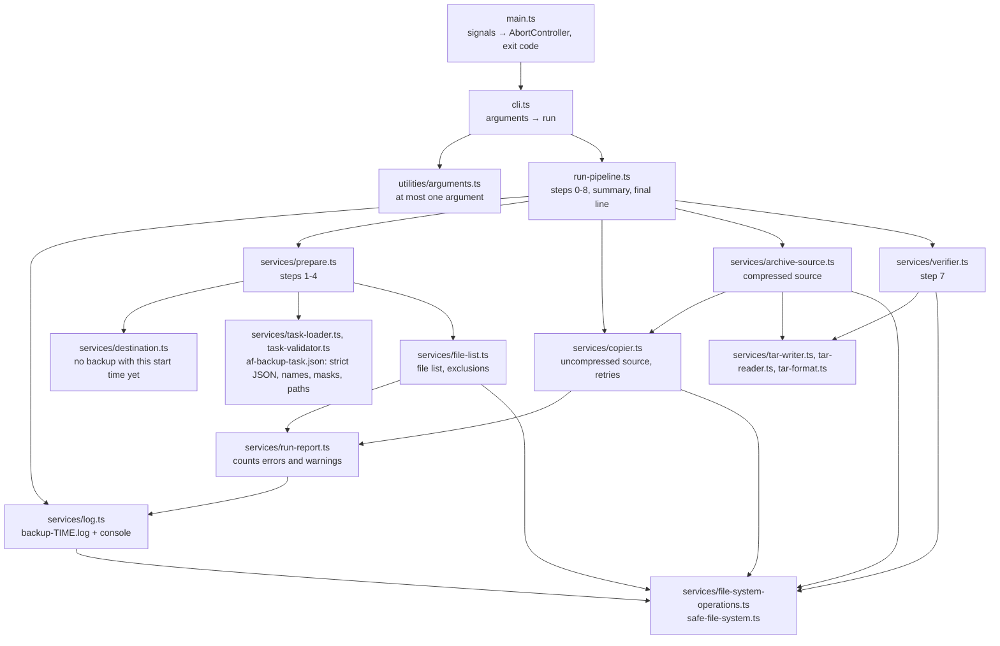
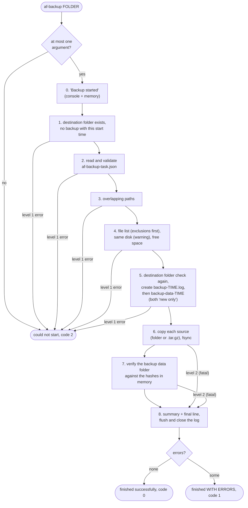
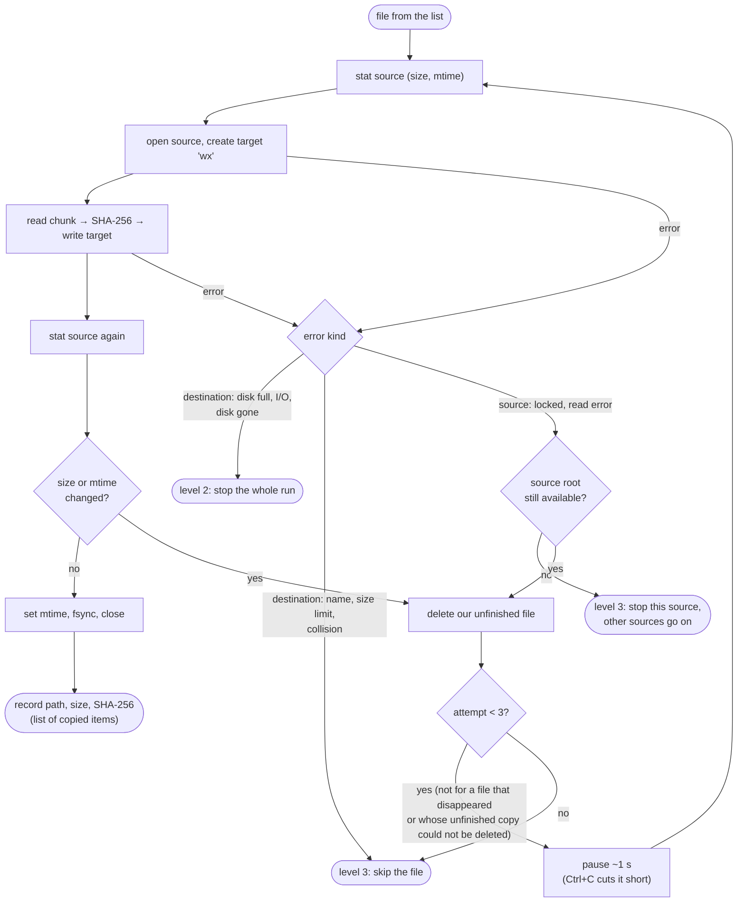
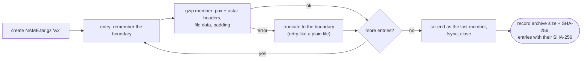
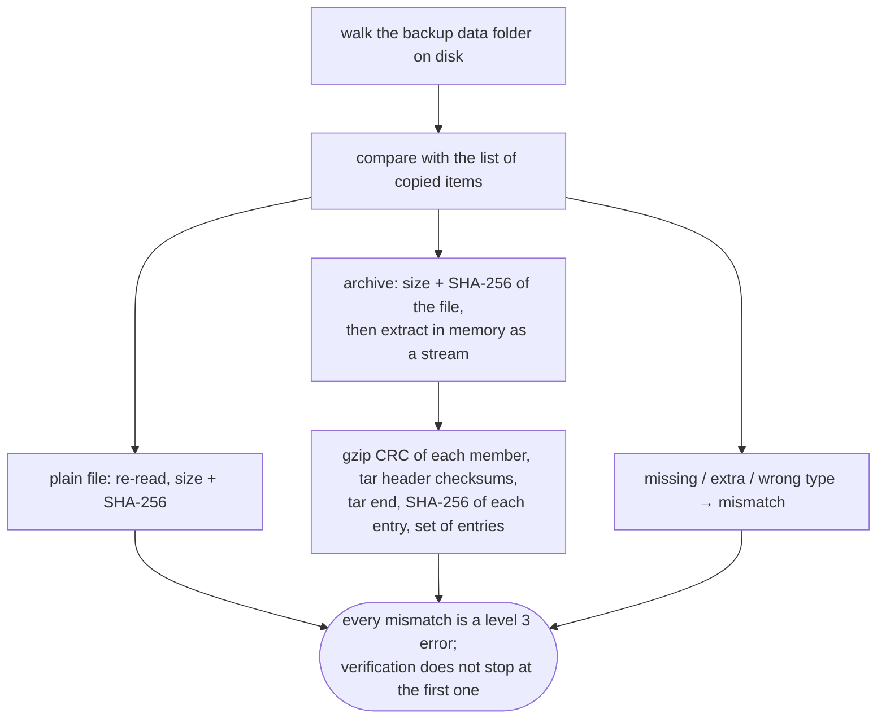

# How AF Backup works

A visual overview of what happens during `af-backup [<destination folder>]`, mapped onto the source code.
[spec.md](spec.md) is the source of truth for behavior; this file only shows how it fits together.

## Modules

Who calls whom. Everything that touches the file system goes through `fileSystemOperations`
(tests replace its methods to simulate faults).

## A run, step by step

TIME below is the start time of the run, `yyyy-mm-dd-HH-MM-SS` (`backup-data-2026-10-04-11-20-15`).

Nothing is changed on disk before step 5: a failure at steps 1-4 (or creating the log file at step 5) is
"could not start", printed to the console only, and nothing is created in the destination folder (except a log file that
was created but could not be written: it stays). The lines produced
before step 5 are kept in memory and written to the log file first when it is created. From the creation of the backup data folder on,
the run always ends with the summary and a final line.

Ctrl+C at any point: before the log file exists - "could not start: interrupted, code 3";
after - copying or verification stops, the summary and "Backup INTERRUPTED, code 3" are written.
A second Ctrl+C exits at once (no final line - the backup is not valid).

## Copying one file (uncompressed source)

`copier.ts`, `withFileRetries` + `copyOnce`. The hash is computed while reading the source;
the target is created only after the source has been opened.

Folders are created as the list is walked (folders come before their content); on Linux and macOS each folder
is flushed to disk after everything inside it has been created.

## Compressed source (`compress: true`)

`archive-source.ts` + `tar-writer.ts`. The archive is written as a chain of gzip members, one per entry,
so a failed entry is rolled back by truncating the file to the last member boundary.

## Verification (step 7)

`verifier.ts` + `tar-reader.ts`. Everything is re-read from the destination; nothing is written to the backup data folder.

## Error levels and the final status

| Level | In code | Effect on the run |
|---|---|---|
| 1 - cannot start | `StartError` | backup data folder not created, "could not start", code 2 |
| 2 - fatal | `FatalError` | copying/verification stops, "WITH ERRORS", code 1 |
| 3 - item error | `RunReport.error()` | item skipped, run goes on, "WITH ERRORS", code 1 |
| 4 - warning | `RunReport.warn()` | logged only, status not affected |
| Ctrl+C | `AbortSignal` → `InterruptedError` | "INTERRUPTED" (or "could not start: interrupted"), code 3 |

The status of a backup exists **only in its log `backup-<start time>.log`**: a backup is valid only if its log ends with
"Backup finished successfully".
